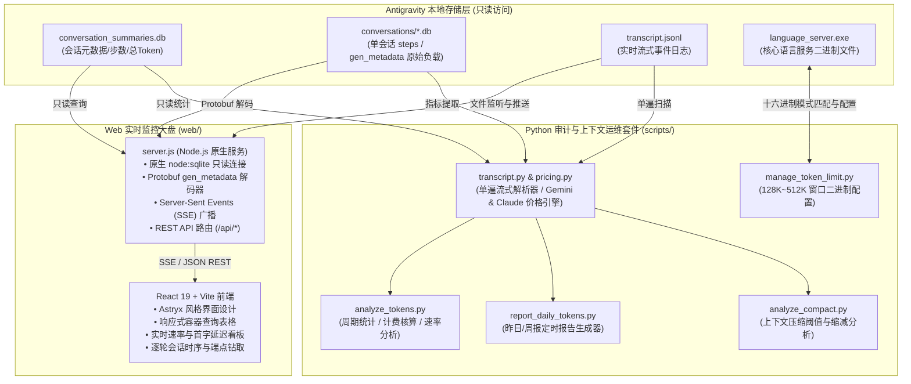

# Antigravity Token Manager & Model Monitor (anti_token_manager)

针对 Google Antigravity 本地开发环境的 Token 消耗审计、成本核算、输出速率监测及物理模型路由大盘工具套件。

项目集成基于 Python 标准库实现的命令行审计工具、定时报告器、上下文限制管理模块，以及基于 React 19 与 Node.js 原生开发的高性能 Astryx 风格实时监测 Web 控制台。

---

## 1. 架构拓扑



---

## 2. 核心特性

### 2.1 零侵入底层端点探测
- 采用 Node.js 原生 `node:sqlite` 并发只读模式读取本地数据库，完全兼容 WAL 机制，不产生文件锁，不干扰 Antigravity 正常对话执行。
- 逐轮流式解码 `gen_metadata` 中的 Protobuf 原始二进制负载，提取字段 19 携带的真实物理模型端点标识（例如 `gemini-3.8-flash`、`gemini-3.8-flash-n`、`gemini-4-argon-trial`、`claude-opus-5-5-high` 等）。

### 2.2 速率与性能多维指标审计
- **流式输出速率 (Stream TPS)**：统计首字到达至输出完成期间的吐字速率（`responseTokens / streamSec`），排除网络预填充与思考推理耗时。
- **端到端速率 (E2E TPS)**：基于完整交互步耗时计算的全局速率（`outputTokens / totalSec`）。
- **首字响应延迟 (Avg TTFT)**：精准衡量输入上下文预填充、网络传输与模型深度思考的等待时长。
- **思维链分离核算**：清晰分离思考推理 Token（`thinkingTokens`）与正文可见 Token（`responseTokens`），展示模型推理占比。

### 2.3 双厂商全模型计费核算
- 内置 Google Gemini（Flash / Argon / Pro / Lite 系列）与 Anthropic Claude（Opus / Sonnet / Haiku 系列）官方价格模型与阶梯计费逻辑。
- 支持基于本地价格缓存文件 `gemini_pricing.json` 与在线实时同步，核算输入 Token、缓存命中 Token 与输出 Token 支出明细。

### 2.4 主子会话递归穿透归集
- 针对 Antigravity 派生的各类子代理（Subagents，如 `research`、`codebase-retriever`、`terminal` 等），自动化工具与 Web 大盘均支持通过 `parent_conversation_id` 进行递归穿透关联，避免遗漏后台子任务的资源消耗。

### 2.5 上下文窗口限制配置与压缩审计
- 支持针对 `language_server` 进行上下文窗口上限配置（`128K`、`256K`、`320K`、`384K`、`512K`、`768K`、`1M`），并提供一键还原默认配置机制。
- 深入底层 x86_64 机器码与 `.rdata` JSON 插槽，解除 Cloud MendelStateCache 云端覆盖与 5 处机器码截断钳制（Clamp），适配 1M 窗口下 Google 官方 `claude-1m_840k` 标准（840K 安全上限，保留 160K 空间用于工具输出扩展与检查点生成）。
- 支持跨平台原子写入机制，在 Windows 上即使 `language_server` 处于运行状态，亦可通过原子重命名无损完成二进制热配置。
- 自动捕捉模型在达到上下文水印时的截断压缩行为（`CHECKPOINT`），分析交互轮次、触发上下文量以及压缩缩减百分比，支持 `--session` 逐步上下文轨迹分析。

---

## 3. 项目目录结构

```
anti_token_manager/
├── README.md                      # 项目技术文档与使用指南
├── LICENSE                        # MIT 开源许可证
├── .gitignore                     # Git 忽略配置
├── requirements.txt               # Python 运行环境说明
├── package.json                   # 根目录 NPM 任务入口
├── start.bat                      # Windows 一键启动脚本
├── scripts/                       # Python 核心审计工具套件
│   ├── analyze_tokens.py          # 多周期/单会话 Token 消耗与成本审计
│   ├── report_daily_tokens.py     # 自动化每日/每周定时审计报告生成器
│   ├── analyze_compact.py         # 上下文压缩行为与阈值动态分析
│   ├── manage_token_limit.py      # 上下文窗口限制配置管理器
│   ├── pricing.py                 # 模型价格表与计费引擎
│   ├── gemini_pricing.json        # 本地价格配置缓存
│   ├── transcript.py              # 高效流式与 SQLite 解析器
│   └── formatter.py               # 控制台格式化与中英双宽对齐
├── web/                           # Web 实时监测大盘
│   ├── package.json               # Web 端依赖声明与脚本
│   ├── vite.config.ts             # Vite 构建与反向代理配置
│   ├── tsconfig.json              # TypeScript 编译配置
│   ├── index.html                 # 页面 HTML 入口
│   ├── server.js                  # 原生 Node.js 服务 (SSE + SQLite 只读)
│   ├── start.bat                  # Web 服务独立启动脚本
│   ├── dist/                      # 预编译生产静态产物 (即开即用)
│   └── src/
│       ├── App.tsx                # 监控大盘主界面组件
│       ├── main.tsx               # React 根入口
│       └── index.css              # 全局样式与容器查询
└── skills/
    └── antigravity-token-manager/ # 可直接载入 Antigravity 的技能配置包
        ├── SKILL.md               # 技能定义与提示词规范
        └── scripts/               # 技能内嵌完整执行脚本
```

---

## 4. 快速开始

### 4.1 环境准备
- **Python**：3.10 或更高版本（纯标准库实现，无需 `pip install` 额外依赖）。
- **Node.js**：18.0.0 或更高版本（用于运行 Web 监控服务 `node:sqlite` 原生模块）。

### 4.2 启动 Web 实时监测大盘

#### 方式 1：双击批处理脚本（推荐）
在 Windows 资源管理器中直接双击根目录下的 `start.bat`。脚本将自动打开默认浏览器访问控制台，并启动后台服务：
```
http://127.0.0.1:3820
```

#### 方式 2：命令行启动
```bash
# 启动内置服务（已预装生产静态产物，无需额外编译）
npm start

# 或直接使用 Node 启动
node web/server.js
```

服务默认监听 `3820` 端口。如需更改端口或自定义 Antigravity 数据目录，可传入环境变量：
```bash
PORT=8080 ANTIGRAVITY_DATA_DIR="C:/Users/YourName/.gemini/antigravity" node web/server.js
```

---

## 5. Python 命令行审计工具使用

### 5.1 会话 Token 审计与成本核算 (`analyze_tokens.py`)

```bash
# 查看今日全模型 Token 消耗、速率及费用总览
python scripts/analyze_tokens.py --period today

# 按天分组查看本周消耗
python scripts/analyze_tokens.py --period this-week --group-by date

# 按周分组查看本月消耗
python scripts/analyze_tokens.py --period this-month --group-by week

# 审计特定会话（自动穿透关联其所有子代理 Subagents）
python scripts/analyze_tokens.py --session 6d9813c0

# 自定义日期区间并导出为 JSON 格式
python scripts/analyze_tokens.py --start 2026-11-01 --end 2026-11-06 --json
```

### 5.2 自动化日报与周报生成 (`report_daily_tokens.py`)

支持生成包含核心指标、模型分布、速率指标、子代理层级分布以及 Top 消耗会话的格式化 Markdown 报告：

```bash
# 生成默认统计报告（周二至周日自动统计昨日；周一自动统计上周七天）
python scripts/report_daily_tokens.py

# 指定审计特定日期的消耗
python scripts/report_daily_tokens.py --date 2026-11-05

# 强制执行周报周期统计
python scripts/report_daily_tokens.py --weekly
```

### 5.3 上下文压缩行为分析 (`analyze_compact.py`)

分析历史会话中模型触发 `CHECKPOINT` 上下文压缩的具体步数、压缩前 Token 量及缩减比例，或钻取指定会话逐步轨迹：

```bash
# 全局统计报告
python scripts/analyze_compact.py

# 钻取指定会话的逐步上下文轨迹与 CHECKPOINT 触发明细
python scripts/analyze_compact.py --session <conversation-id>
```

### 5.4 语言服务上下文窗口配置 (`manage_token_limit.py`)

修改或检查 `language_server` 运行时的上下文最大 Token 限制（支持 128K、256K、320K、384K、512K、768K、1M / 840K）：

```bash
# 1. 查看当前各模型上下文限制状态、机器码钳制与 Mendel 状态
python scripts/manage_token_limit.py --status

# 2. 将全部模型窗口升级至指定档位（例如 512K / 768K / 1M）
python scripts/manage_token_limit.py --set 512k
python scripts/manage_token_limit.py --set 768k
python scripts/manage_token_limit.py --set 1m

# 3. 针对指定模型独立配置（例如仅将 Argon 设为 1M）
python scripts/manage_token_limit.py --set 1m --model argon

# 4. 恢复官方默认基线 (Flash 128K, Argon 256K, Clamp 256K, Cloud Mendel 生效)
python scripts/manage_token_limit.py --restore
```
> 注意：配置修改后，需完全退出并重启 Antigravity 应用程序以使新的上下文水印与限制生效。

---

## 6. Antigravity Skill 集成

本项目完整支持作为原生技能载入 Antigravity。

只需将本项目中的 `skills/antigravity-token-manager` 文件夹复制到用户配置目录下的技能库中：
```powershell
Copy-Item -Path "skills/antigravity-token-manager" -Destination "$HOME\.gemini\config\skills\" -Recurse -Force
```
安装后，可在 Antigravity 对话中直接调用该技能进行日常审计、消耗统计与上下文调优。

---

## 7. Web 后端 API 说明

| 端点 | 请求方法 | 描述 |
| :--- | :--- | :--- |
| `/api/overview` | `GET` | 获取全局统计指标（总会话数、总调用次数、Token 消耗分类、全局速率及各模型统计） |
| `/api/sessions` | `GET` | 分页或全量获取会话列表，包含端点分布、步数、Token 消耗、TTFT 与 TPS 速率 |
| `/api/models` | `GET` | 获取各物理端点（Gemini / Claude）的累计调用数、速率及 Token 汇总 |
| `/api/conversations/:id` | `GET` | 查询指定会话的完整明细，包含各步的输入/输出 Token、耗时、物理端点及元数据 |
| `/api/events` | `GET` | 基于 SSE (Server-Sent Events) 的实时事件流，底层数据库变更时自动向前端推送更新 |

---

## 8. 开源协议

本项目基于 [MIT License](LICENSE) 协议发布。
