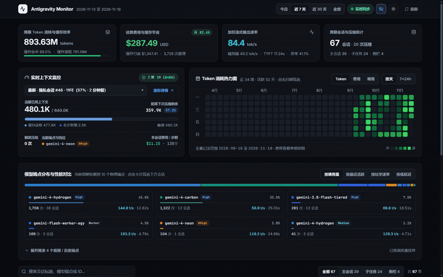
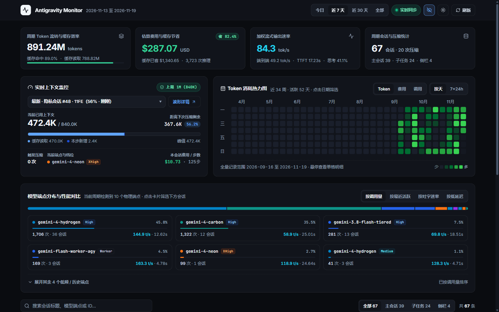
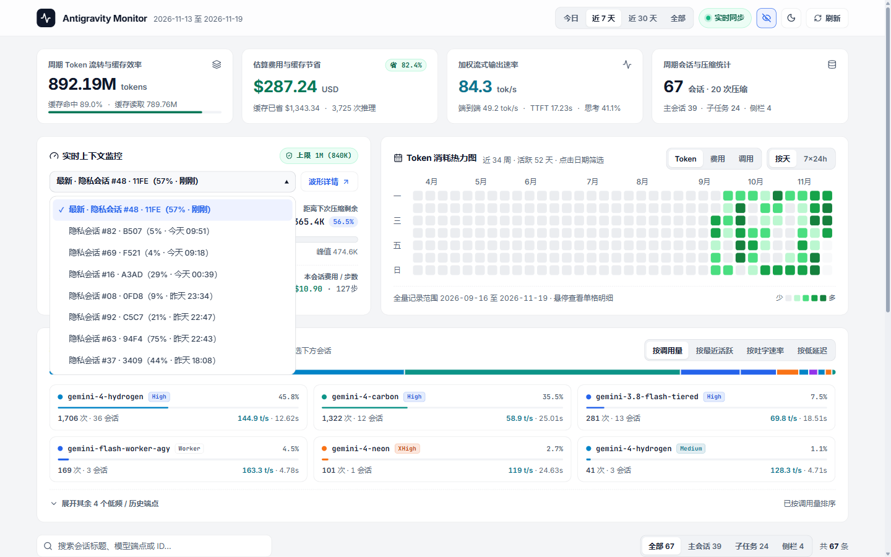
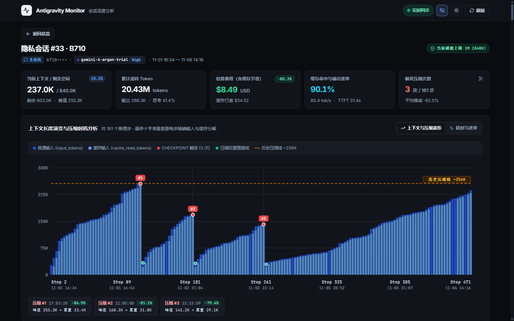
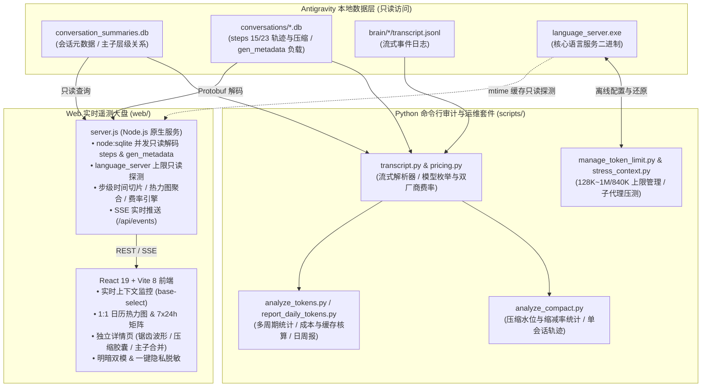

# Antigravity Token Manager & Telemetry Monitor

[](https://www.python.org/)
[](https://nodejs.org/)
[](https://react.dev/)
[](LICENSE)

面向 Google Antigravity 本地开发环境的 **Token 消耗审计、实时上下文水位监控、全模型与思考档位遥测、上下文压缩波形分析及窗口上限运维套件**。

项目全部后端解析均采用纯只读方式直接解码 Antigravity 本地 SQLite（`steps` / `gen_metadata` / `conversation_summaries.db`），Python 命令行工具链零第三方依赖，Web 端基于原生 `node:sqlite` + SSE 与 React 19 构建，即开即用。

<p align="center">
  
</p>

<p align="center">
  <a href="docs/assets/demo.mp4"><strong>观看完整高清演示视频 (MP4, 1280×800)</strong></a>
  &nbsp;·&nbsp;
  <a href="#2-界面预览"><strong>查看高清界面截图</strong></a>
  &nbsp;·&nbsp;
  <a href="#4-快速开始"><strong>30 秒快速上手</strong></a>
  &nbsp;·&nbsp;
  <a href="#5-python-命令行审计与运维套件"><strong>CLI 审计与上限管理</strong></a>
</p>

---

## 1. 核心能力

### 1.1 实时上下文监控与真实上限探测
- **零侵入只读探测 `language_server` 实际生效上限**：自动识别本机 `language_server` 二进制的 Pattern 1/3/4 配置与 Cloud Mendel 覆盖状态，实时显示当前真实阈值（如 `1M (840K)` 或默认 `256K`）。
- **活跃会话水位驾驶舱**：自动锁定最新活跃主会话，通过定制化下拉选择器（原生 `appearance: base-select`）快速切换最近活跃会话；通过 SSE 实时更新**当前已用上下文、距离下次压缩剩余安全空间、缓存读取 vs 本步新增双段进度条、当前端点与思考档位及已触发压缩次数**。

### 1.2 全模型物理端点与思考档位精准归因
- 同步解码 `gen_metadata`（Protobuf 字段 19 物理端点标识）与 `steps`（`model_enum` 枚举 ID），还原全系列模型及精确思考档位：
  - **Google Gemini 4 系列**：`gemini-4-neon (XHigh / High / Medium)`、`gemini-4-hydrogen (High / Medium)`、`gemini-4-hydrogen-tiered (High)`、`gemini-4-carbon (High / Medium)`、`gemini-4-argon (High)`、`gemini-pro-orchestrator (Carbon / Argon / Neon)`
  - **Google Gemini 3.x 与 Worker 系列**：`gemini-3.8-flash (High / Medium)`、`gemini-3.8-flash-tiered (High)`、`gemini-flash-worker-agy (Worker)`、`gemini-3.5-flash-lite`、`gemini-3.1-pro`
  - **Anthropic Claude 系列**：`claude-opus-5-5 (Max / High / Medium / Low)`、`claude-sonnet-5-5`、`claude-opus-4-6 (Thinking)`、`claude-sonnet-4-6`、`claude-haiku-4-5`
- 支持在模型排行榜中按**调用量 / 最近活跃 / 吐字速率 / 低延迟**四维排序，直接横向对比同模型不同思考档位的流式输出速度（`tok/s`）与首字等待时间（`TTFT`）。

### 1.3 全局步级时间切片与 Token 消耗热力图
- **精确步级时间范围**：顶栏支持一键切换 **`今日` / `近 7 天`（默认）/ `近 30 天` / `全部`**，按每步真实发生时间戳聚合统计，明确标出起止日期。
- **双视图消耗热力图**：
  - **按天日历热力图**：严格 1:1 正方形 34 周翡翠色阶点阵，支持切换 `Token / 费用 / 调用` 指标，悬停查看单日明细，**点击任意日期联动过滤下方会话明细表**；
  - **`7×24h` 时段热力矩阵**：按星期 × 24 小时呈现全历史活跃分布，直观识别个人开发高频消耗时段。

### 1.4 独立全幅会话深度分析（锯齿上下文波形 + 压缩轨迹）
- 点击任意会话进入独立的宽幅详情视图（支持 `#/session/<id>` 路由、浏览器前进后退与 `Esc` 秒回原滚动位置）：
  - **双色锯齿上下文演变图**：堆叠呈现每步的普通输入（`input_tokens`）与缓存复用（`cache_read_tokens`），绘制上限参考虚线、`CHECKPOINT` 红色触发锚点、绿色基线重置点与顶部派生子智能体活跃泳道。
  - **零遮挡交互体验**：鼠标滑过波形即触发十字准星与顶部实时精确读数条；画布下方横向排列压缩快照胶囊（峰值、重置值、压缩缩减率），点击即可高亮波峰并定位至对应轮次与内联压缩分割横幅。
  - **耗时与速率双视图 + 主子合并账单**：一键切换至逐轮 `TTFT / Stream` 耗时堆叠图；自动关联 `parent_conversation_id` 汇总主会话与所有派生子智能体的合并 Token 与费用。

### 1.5 双厂商费用与缓存节省核算 + 一键隐私脱敏
- 内置与 [gemini_pricing.json](scripts/gemini_pricing.json) 同源的双厂商费率引擎，精确计算实际估算费用及**对比无缓存节省的金额与比例**（如省 `82%`）。
- **一键隐私脱敏模式**：顶栏提供隐私模式开关（亦支持 `?privacy=1` 直达），开启后保留 100% 真实统计、热力图、档位与锯齿波形，同时对所有会话标题、下拉选项、子任务名称与长 ID 执行确定性不可逆脱敏，方便分享截图与录屏。
- **自适应明暗双模**：遵循系统浅色 / 深色偏好并提供顶栏两态即时切换，零白屏闪烁（FOUC），适配暗色滚动条与 WCAG AA 对比度。

---

## 2. 界面预览

### 深色模式总览大盘（KPI + 实时上下文监控 + 34 周热力图 + 模型分档排行）


### 浅色模式总览与定制活跃会话选择器


### 独立会话详情页（双色锯齿上下文演变 + CHECKPOINT 压缩锚点与胶囊跳转）


---

## 3. 系统架构拓扑



---

## 4. 快速开始

### 4.1 环境准备
- **Node.js**：`22.5.0` 或更高版本（内置原生 `node:sqlite`，无需额外安装原生编译依赖）。
- **Python**：`3.10` 或更高版本（CLI 套件纯标准库实现，无需 `pip install`）。

### 4.2 启动 Web 实时遥测大盘

**方式一：Windows 一键启动**
双击根目录下的 [start.bat](start.bat)，自动拉起本地服务并在浏览器打开：
```text
http://127.0.0.1:3820
```

**方式二：命令行启动（生产静态产物已预构建，开箱即用）**
```bash
# 直接通过 npm 启动
npm start

# 或直接使用 Node 启动
node web/server.js

# 自定义端口与 Antigravity 数据目录
PORT=8080 ANTIGRAVITY_DATA_DIR="C:/Users/YourName/.gemini/antigravity" node web/server.js
```

> 提示：访问 `http://127.0.0.1:3820/?privacy=1` 可直接以**隐私脱敏模式**打开，适合录屏或截图分享。

### 4.3 二次开发与前端构建
```bash
cd web
npm install
npm run dev    # 本地热更新开发
npm run build  # 重新生成 web/dist 生产产物
```

---

## 5. Python 命令行审计与运维套件

### 5.1 多周期 / 单会话 Token 与成本审计 (`analyze_tokens.py`)
```bash
# 查看今日全模型（含档位）Token 消耗、速率与估算费用
python scripts/analyze_tokens.py --period today

# 按天分组查看本周消耗
python scripts/analyze_tokens.py --period this-week --group-by date

# 按周分组查看本月消耗
python scripts/analyze_tokens.py --period this-month --group-by week

# 审计特定会话（自动递归穿透归集所有派生子智能体）
python scripts/analyze_tokens.py --session <conversation-id-prefix>

# 自定义日期区间并导出 JSON
python scripts/analyze_tokens.py --start 2026-11-01 --end 2026-11-19 --json
```

### 5.2 自动化日报与周报 (`report_daily_tokens.py`)
```bash
# 默认模式（周二至周日统计昨日；周一自动统计过去 7 天）
python scripts/report_daily_tokens.py

# 指定特定日期或强制输出周报
python scripts/report_daily_tokens.py --date 2026-11-18
python scripts/report_daily_tokens.py --weekly
```

### 5.3 上下文压缩行为分析 (`analyze_compact.py`)
```bash
# 全局统计各模型压缩触发阈值与缩减率
python scripts/analyze_compact.py

# 钻取单会话的逐步上下文演变与 CHECKPOINT 触发明细
python scripts/analyze_compact.py --session <conversation-id>
```

### 5.4 语言服务上下文窗口配置 (`manage_token_limit.py`)
支持检查或配置 `language_server` 运行时上下文上限（`128K` / `256K` / `320K` / `384K` / `512K` / `768K` / `1M (840K)`），覆盖静态 JSON 槽位（`Flash 3.8 M124`、`Argon/Carbon M408`、`Claude 5.5 M400`）及云端动态模型基线（`Gemini 4 Neon M533`、`Gemini 4 Hydrogen`、`Orchestrator`、`Carbon M427`）：

```bash
# 1. 查看当前静态槽位、动态云端基线、机器码钳制与 Cloud Mendel 状态
python scripts/manage_token_limit.py --status

# 2. 升级全部模型上下文上限（1m 自动配置为 840K 安全上限，预留 160K 空间）
python scripts/manage_token_limit.py --set 512k
python scripts/manage_token_limit.py --set 1m

# 3. 针对指定模型范围调整
python scripts/manage_token_limit.py --set 512k --model flash
python scripts/manage_token_limit.py --set 1m --model neon
python scripts/manage_token_limit.py --set 1m --model hydrogen
python scripts/manage_token_limit.py --set 1m --model orchestrator

# 4. 一键恢复官方默认配置（支持构建版本校验与安全就地还原）
python scripts/manage_token_limit.py --restore
```
> 注意：修改上限配置后需完全退出并重启 Antigravity 客户端使新阈值生效。

### 5.5 子代理上下文窗口压测校验 (`stress_context.py`)
```bash
# 1. 生成确定性压测载荷
python scripts/stress_context.py --prepare --out-dir .stress_data --target 1m

# 2. 通过子代理加载完毕后核验实测触发上限
python scripts/stress_context.py --verify <subagent-conversation-id> --expected 1m

# 3. 清理临时载荷
python scripts/stress_context.py --cleanup --out-dir .stress_data
```

---

## 6. Antigravity 原生插件集成

本仓库可直接作为 **Antigravity 原生插件**（包含右侧辅助面板 Sidecar UI、零依赖只读 MCP Server、高水位预警 Hook、Skill 与 Rules）安装使用，同时保留独立 Web 与 Python CLI 形态：

```bash
# 安装精简原生插件产物到 ~/.gemini/config/plugins/antigravity-token-manager
# --migrate-skill 会自动备份并移出旧的独立 Skill，避免同名冲突
npm run plugin:install

# 运行全链路自检（Manifest / Sidecar HTTP & SSE / MCP 4 工具 / Hook）
npm run plugin:verify

# 卸载插件
npm run plugin:uninstall
```

安装完成后，插件随 Antigravity 自动发现：
- **右侧辅助面板（Sidecar UI）**：自动随插件启停，打开后默认锁定当前正在进行的对话上下文水位、剩余压缩安全空间与锯齿波形，支持窄侧栏三标签紧凑模式，并跟随宿主明暗主题。
- **内置只读 MCP 工具**：直接提供 `token_get_overview`、`token_get_session_audit`、`token_get_context_limit`、`token_get_daily_report`，在对话中提问 Token 消耗、速率或账单即可由 Agent 直接调用。
- **上下文高水位预警 Hook**：当单会话上下文占用超过 `85%` 时，在界面内联提醒（不占用模型输入上下文 Token，每个压缩周期仅提示一次）；可在插件数据目录的 `settings.json` 中通过 `{"enabled": false}` 或调整 `thresholdPct` 自定义。

---

## 7. Web 后端 API 说明

| 端点 | 方法 | 查询参数与返回说明 |
| :--- | :--- | :--- |
| `/api/overview` | `GET` | 支持 `?range=today\|7d\|30d\|all` 或 `?date=YYYY-MM-DD`。返回周期内汇总 Token、费用与缓存节省、压缩总数、分模型与档位速率/延迟、`contextConfig`（实测上限）及 `activeSessions`（活跃会话水位快照）。 |
| `/api/heatmap` | `GET` | 返回全历史按自然日聚合的 `daily` 数组及 `7×24h` 活跃 `hourlyMatrix`（含 Token、费用、调用次数与压缩次数）。 |
| `/api/sessions` | `GET` | 支持 `range`、`date`、`search`、`model`、`type`、`page`、`pageSize`。返回带实时上下文水位、压缩次数、子任务数量与估算费用的会话列表。 |
| `/api/sessions/:id` | `GET` | 返回单会话完整逐轮轨迹（含真实 `stepIndex`、`timestampMs`、模型与思考档位、耗时、费用）、`checkpoints` 压缩事件清单、`childSessions` 关联子智能体与 `parentSession` 引用。 |
| `/api/events` | `GET` | 基于 SSE（Server-Sent Events）的实时推送流，监听本地 SQLite 目录变更并自动触发前端无刷新同步。 |

---

## 8. 项目目录结构

```text
anti_token_manager/
├── README.md                              # 项目文档与使用指南
├── LICENSE                                # MIT 开源协议
├── .gitignore                             # Git 忽略配置
├── package.json                           # 根目录 NPM 启动入口
├── requirements.txt                       # Python 运行环境说明
├── start.bat                              # Windows 一键启动脚本
├── docs/
│   └── assets/                            # 演示动图、高清 MP4 视频与界面截图
│       ├── demo-preview.gif
│       ├── demo.mp4
│       ├── overview-dark.png
│       ├── overview-light.png
│       └── session-detail.png
├── scripts/                               # Python 零依赖审计与运维套件
│   ├── analyze_tokens.py                  # 多周期 / 单会话 Token 与成本审计
│   ├── report_daily_tokens.py             # 每日 / 每周报告生成器
│   ├── analyze_compact.py                 # 上下文压缩行为与单会话轨迹分析
│   ├── manage_token_limit.py              # 上下文窗口限制配置管理器
│   ├── stress_context.py                  # 子代理上下文窗口压测工具
│   ├── pricing.py                         # 双厂商费率与 model_enum 映射引擎
│   ├── gemini_pricing.json                # 本地价格配置缓存
│   ├── transcript.py                      # SQLite 与 JSONL 流式解析器
│   └── formatter.py                       # 终端表格格式化与东亚宽字符对齐
├── web/                                   # Web 实时遥测大盘
│   ├── server.js                          # 原生 Node.js 服务 (node:sqlite + SSE)
│   ├── index.html                         # 页面入口 (含防 FOUC color-scheme 脚本)
│   ├── package.json                       # 前端构建依赖声明
│   ├── tsconfig.json                      # TypeScript 配置
│   ├── vite.config.ts                     # Vite 8 构建配置
│   ├── dist/                              # 预编译生产静态产物 (开箱即用)
│   └── src/
│       ├── App.tsx                        # 总览页与独立详情路由统筹
│       ├── types.ts                       # 类型定义、模型分档与隐私脱敏工具
│       ├── index.css                      # 明暗双模令牌、base-select 与响应式样式
│       ├── main.tsx                       # React 19 根入口
│       ├── vite-env.d.ts                  # Vite 客户端类型声明
│       └── components/
│           ├── ContextMonitorCard.tsx     # 实时上下文监控驾驶舱
│           ├── TokenHeatmap.tsx           # 1:1 按天日历热力图 & 7x24h 矩阵
│           ├── SessionDetailPage.tsx      # 独立会话详情页 (锯齿波形 / 压缩胶囊 / 主子合并)
│           └── ModelBadge.tsx             # 物理端点与思考档位微标组件
└── skills/
    └── antigravity-token-manager/         # Antigravity 原生 Skill 集成包
        ├── SKILL.md
        └── scripts/
```

---

## 9. 免责声明（Disclaimer）

1. 本项目仅供个人本地开发学习、性能统计与技术研究交流使用，与 Google 官方及 Google Antigravity 团队无任何隶属、合作或官方背书关系。
2. 仓库中的 `analyze_tokens.py`、`report_daily_tokens.py`、`analyze_compact.py` 及 Web 监控服务均采用纯只读方式解析本地日志与数据库，不修改客户端状态，亦不会上传任何用户会话数据或密钥。
3. `manage_token_limit.py` 涉及对本地 `language_server` 二进制文件的离线配置调整。客户端版本升级、系统环境差异或不当操作可能导致配置失效、程序启动异常或其他不可预知的问题。执行修改前请务必确认已生成备份文件，出现异常时可通过 `--restore` 参数或重新安装官方客户端恢复。
4. 使用者应自行评估并承担使用本仓库代码与脚本所产生的一切风险及潜在后果（包括但不限于程序运行异常、本地数据损坏、服务条款合规风险或账号状态变动等），本项目作者及贡献者不对任何直接、间接、偶然或连带损失承担任何形式的法律或赔偿责任。

---

## 10. 开源协议

本项目基于 [MIT License](LICENSE) 协议发布。
